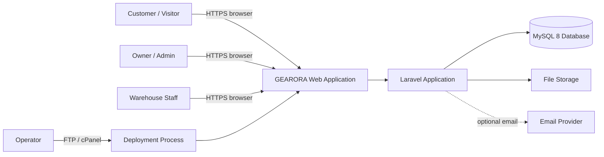
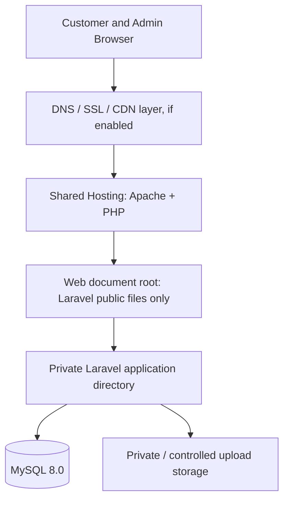
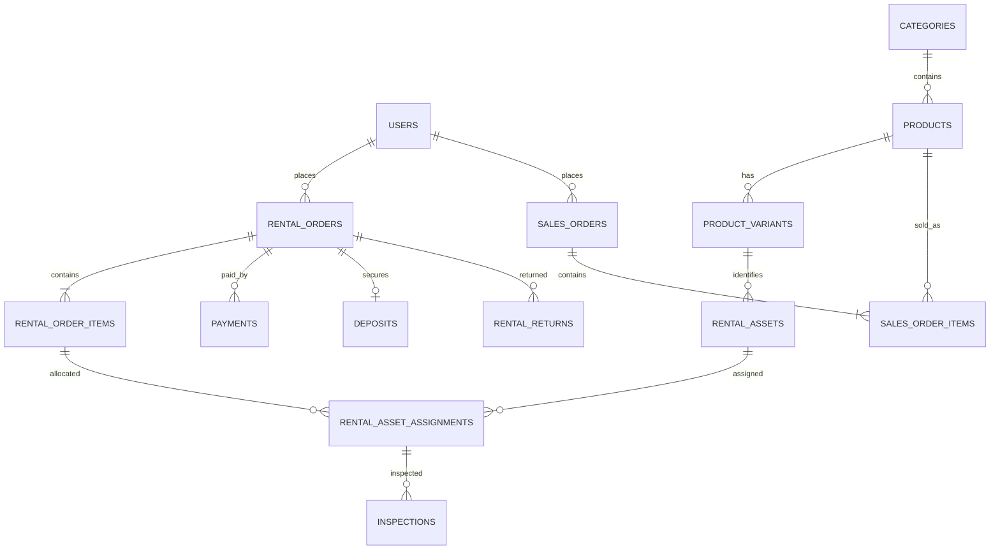
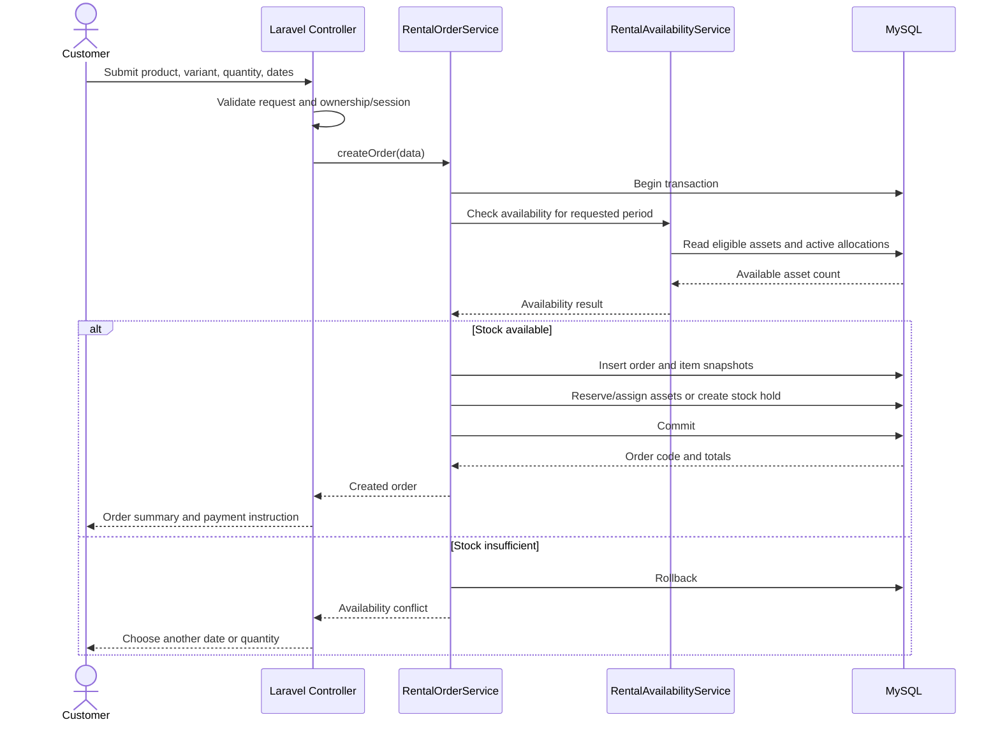

# Software Architecture — GEARORA

> **Product:** GEARORA — Outdoor Supply  
> **Document version:** 1.0  
> **Date:** 16 November 2026  
> **Architecture style:** Modular monolith, MVC, Service Layer, relational database

---

## 1. Tujuan Arsitektur

Dokumen ini mendefinisikan struktur teknis GEARORA agar alur pelanggan dan Admin Dashboard berjalan di atas satu aplikasi yang konsisten. Arsitektur harus cukup rapi untuk memisahkan aturan bisnis rental, penjualan, inventaris, pembayaran, dan pengembalian, tetapi tidak terlalu kompleks untuk proyek PSAS dan deployment pada shared/free hosting.

## 2. Prinsip Arsitektur

1. **Modular monolith:** satu aplikasi Laravel dan satu database MySQL; modul dipisahkan secara logis tanpa microservices.
2. **Server-rendered first:** gunakan Blade untuk halaman utama dan Admin Dashboard. JavaScript hanya untuk interaksi yang memang membutuhkan state di browser.
3. **Business rules in services:** aturan harga, ketersediaan, perubahan status, alokasi unit, deposit, dan inspeksi tidak diletakkan langsung di Blade atau controller.
4. **Database as source of truth:** stok, status transaksi, pembayaran, dan aset ditentukan oleh data database, bukan state frontend.
5. **Authorization on server:** route, controller, service, dan query harus menjaga akses sesuai role/permission.
6. **Deployment-aware:** aplikasi tidak boleh bergantung pada Node.js, Composer, queue worker, WebSocket, atau proses daemon yang harus berjalan di hosting.
7. **Incremental delivery:** modul inti rental/inventory diselesaikan sebelum modul lanjutan.

## 3. System Context



Email provider bersifat opsional. Payment gateway, real-time chat, dan integrasi eksternal bukan dependensi MVP.

## 4. Deployment / Runtime Topology



### 4.1 Batas keamanan direktori

- Web server harus mengarahkan request ke `public/index.php` Laravel.
- Folder `app`, `bootstrap`, `config`, `database`, `resources`, `routes`, `storage`, `vendor`, dan file `.env` tidak boleh dapat diakses sebagai file publik.
- Idealnya source Laravel berada di luar `public_html`; hanya isi direktori `public/` yang menjadi document root.
- Bila hosting tidak memungkinkan pengaturan document root, verifikasi pola deployment yang aman dengan folder aplikasi privat di luar document root dan `public_html` hanya berisi file publik serta `index.php` yang mengarah ke bootstrap aplikasi.
- Jika hosting memaksa seluruh source berada di dalam web root tanpa mekanisme perlindungan yang dapat diverifikasi, deployment produksi harus dihentikan sampai ditemukan konfigurasi yang aman.

## 5. Layered Application Design

| Layer | Tanggung jawab | Contoh |
|---|---|---|
| Presentation | Request, response, halaman, form, dan validasi input awal | Blade, Controllers, Form Requests |
| Application | Mengorkestrasi use case dan transaksi bisnis | Services / Actions |
| Domain | Entitas, enum status, aturan rental, aturan harga dan inventaris | Eloquent Models, Enums, domain rules |
| Infrastructure | Database, storage, email, logging, framework adapters | MySQL, Laravel Storage, Log |

### 5.1 Alur Request Umum

1. Browser mengirim HTTP request ke route.
2. Middleware memeriksa sesi, autentikasi, role/permission, dan rate limit bila diperlukan.
3. Form Request memvalidasi payload.
4. Controller memanggil Service/Action.
5. Service menerapkan aturan domain dan menggunakan database transaction ketika mengubah data penting.
6. Model/Eloquent berinteraksi dengan MySQL.
7. Controller mengembalikan Blade view atau redirect dengan flash message.

Controller harus tipis. Blade tidak boleh menghitung ketersediaan atau memutuskan status transaksi.

## 6. Modul Aplikasi

```text
GEARORA
├── Public Website
│   ├── Homepage
│   ├── Catalog & Search
│   ├── Product Detail
│   ├── Customer Account
│   ├── Rental Cart / Order
│   ├── Sales Catalog / Order
│   ├── Trip Planner
│   └── Equipment Guides
│
└── Admin Console
    ├── Dashboard
    ├── Users, Roles & Permissions
    ├── Categories, Products & Variants
    ├── Inventory & Stock Movements
    ├── Rental Orders & Asset Assignments
    ├── Payments & Deposits
    ├── Pickup, Returns & Inspections
    ├── Additional Charges
    ├── Sales Orders
    ├── Trip Recommendation Rules
    ├── Guides / Content
    └── Reports
```

### 6.1 Suggested Laravel Folder Organization

Gunakan struktur Laravel konvensional, dengan pemisahan service berdasarkan domain. Contoh struktur target (bukan keharusan membuat semua folder sekaligus):

```text
app/
├── Enums/
│   ├── ProductType.php
│   ├── RentalOrderStatus.php
│   ├── PaymentStatus.php
│   ├── RentalAssetStatus.php
│   └── InspectionCondition.php
├── Http/
│   ├── Controllers/
│   │   ├── Public/
│   │   ├── Customer/
│   │   └── Admin/
│   ├── Middleware/
│   └── Requests/
│       ├── Customer/
│       └── Admin/
├── Models/
├── Policies/
└── Services/
    ├── CatalogService.php
    ├── InventoryService.php
    ├── RentalAvailabilityService.php
    ├── RentalPricingService.php
    ├── RentalOrderService.php
    ├── RentalHandoverService.php
    ├── ReturnInspectionService.php
    ├── PaymentVerificationService.php
    ├── DepositService.php
    ├── SalesOrderService.php
    ├── TripRecommendationService.php
    └── ReportService.php
```

Hindari membuat Repository untuk setiap model tanpa kebutuhan. Eloquent sudah menyediakan abstraction database; Service Layer cukup untuk memusatkan aturan bisnis.

## 7. Domain dan Data Model Konseptual

Ini adalah rancangan domain awal yang diturunkan dari proses bisnis GEARORA. Struktur final harus disesuaikan setelah ERD divalidasi.

### 7.1 Identity & Access

- `users`: data akun pelanggan dan staf.
- `roles`: Owner, Admin, Warehouse Staff, Customer (role customer dapat menjadi default).
- `permissions`: izin spesifik seperti `products.manage`, `payments.verify`, `returns.process`.
- `role_user`: penghubung user dan role.
- `permission_role`: penghubung role dan permission.

Jika implementasi awal memilih satu role per user, relasi dapat dibuat lebih sederhana, tetapi desain permission tetap harus memeriksa hak pada server.

### 7.2 Catalog & Inventory

- `categories`: kategori produk.
- `products`: identitas dan informasi utama barang, tipe `rental`, `sale`, atau `both`.
- `product_variants`: ukuran, kapasitas, warna, dan SKU/atribut yang memengaruhi stok atau harga.
- `rental_assets`: unit fisik yang dapat disewakan secara individual, termasuk kode aset, kondisi, dan status.
- `stock_movements`: jejak barang masuk, keluar, penyesuaian, rusak, dan hilang.

Produk rental idealnya dilacak sampai unit fisik supaya serah-terima dan inspeksi dapat dikaitkan dengan aset yang tepat. Untuk barang jual, stok dapat dikelola pada tingkat varian.

### 7.3 Rental

- `rental_orders`: header pesanan, pelanggan, kode transaksi, tanggal sewa/kembali, status, subtotal, biaya, dan total.
- `rental_order_items`: varian, kuantitas, harga sewa snapshot, durasi, dan total per item.
- `rental_asset_assignments`: unit fisik yang dialokasikan ke item order.
- `rental_handovers`: waktu dan petugas serah-terima serta kondisi awal.
- `rental_returns`: waktu kembali, petugas penerima, dan status pengembalian.
- `inspections`: kondisi unit, kelengkapan, catatan, dan bukti foto terkait.
- `additional_charges`: denda/biaya yang disahkan dengan alasan dan nominal.

### 7.4 Payment & Deposit

- `payments`: metode, nominal, status, bukti pembayaran, waktu verifikasi, dan verifier.
- `deposits`: nominal jaminan, status, nominal dikembalikan/dipotong, alasan, dan waktu penyelesaian.

Pembayaran dan deposit harus terpisah dari rental order agar pelacakan uang muka, pelunasan, pengembalian dana, dan uang jaminan tidak tercampur.

### 7.5 Sales & Content

- `sales_orders`, `sales_order_items`: transaksi pembelian dan snapshot produk/harga.
- `trip_plans` (opsional): input rencana perjalanan jika riwayat rekomendasi ingin disimpan.
- `trip_recommendation_rules`: aturan mapping aktivitas/durasi/jumlah peserta ke produk atau kategori.
- `guides`: artikel panduan dan metadata publikasi.
- `activity_logs` (direkomendasikan): audit untuk aksi sensitif.

### 7.6 Relasi tingkat tinggi



Diagram ini menunjukkan relasi inti secara konseptual, bukan seluruh kolom atau constraint final.

## 8. Status dan State Transitions

### 8.1 Rental Order

Status baseline:

`pending_payment` → `payment_review` → `confirmed` → `ready_for_pickup` → `picked_up` → `return_review` → `completed`

Status alternatif: `rejected`, `cancelled`, `overdue`.

Catatan:
- `overdue` dapat dihitung dari due date dan status yang belum selesai; tidak harus mengubah order secara otomatis melalui cron.
- Setiap perubahan status harus dilakukan melalui method/service yang memvalidasi transisi yang diperbolehkan.
- Pembatalan harus menyimpan alasan dan tidak menghapus riwayat.
- `completed` hanya setelah proses pengembalian serta kewajiban pembayaran/deposit diselesaikan sesuai kebijakan.

### 8.2 Payment

`unpaid` → `proof_submitted` → `verified`

Alternatif: `rejected`, `refunded`, `partially_refunded`.

### 8.3 Rental Asset

`available`, `reserved`, `rented`, `maintenance`, `damaged`, `lost`.

Jangan menyamakan status pesanan dengan status unit fisik. Satu order dapat berisi beberapa unit dengan kondisi/status berbeda.

## 9. Availability & Anti-Overbooking

Ketersediaan tidak boleh dihitung hanya dari kolom stok total. Untuk setiap varian dan periode:

1. Ambil daftar aset fisik dengan kondisi layak dan status yang dapat disewakan.
2. Identifikasi assignment pada order yang periode sewanya beririsan dan statusnya masih memblokir stok.
3. Hitung jumlah unit bebas.
4. Bandingkan dengan jumlah yang diminta.
5. Saat order dikonfirmasi/disimpan, ulangi validasi di dalam database transaction dan gunakan row locking pada baris stok/aset yang relevan.
6. Simpan assignment aset agar unit yang sama tidak dapat dialokasikan ke dua rental aktif yang beririsan.

Aturan irisan periode perlu konsisten. Baseline yang disarankan: rental A dan B bentrok ketika `A.start_date < B.end_date` dan `A.end_date > B.start_date`, dengan definisi tanggal pengambilan/pengembalian yang telah disepakati. Implementasi final harus menguji kasus peminjaman berurutan pada hari yang sama.

## 10. Alur Teknis Kritis

### 10.1 Pembuatan Rental Order



### 10.2 Manual Payment Verification

1. Customer mengunggah bukti melalui endpoint yang memvalidasi jenis dan ukuran file.
2. File disimpan dengan nama acak pada lokasi yang tidak dapat dieksekusi sebagai script.
3. Payment disimpan sebagai `proof_submitted`.
4. Admin membuka detail payment dan mencocokkan nominal serta referensi transfer.
5. Admin memilih verified/rejected dengan catatan.
6. Sistem mencatat verifier dan timestamp, lalu memperbarui status order melalui workflow service.

### 10.3 Pickup & Return

1. Sistem mengambil assignment unit pada order.
2. Petugas memeriksa unit dan aksesori, lalu mencatat kondisi awal.
3. Setelah serah-terima, assignment/unit berubah menjadi rented.
4. Saat kembali, petugas mencatat waktu dan kondisi akhir.
5. Unit yang layak kembali tersedia; unit rusak masuk maintenance/damaged; unit hilang ditandai lost.
6. Biaya tambahan dan status deposit diproses sesuai ketentuan tertulis.

## 11. Route Organization

Gunakan route web server-rendered; API terpisah tidak diperlukan untuk MVP.

```text
/                         public.home
/katalog                  catalog.index
/produk/{slug}            products.show
/rekomendasi              trip-planner.create
/panduan                  guides.index
/panduan/{slug}           guides.show
/akun/*                   customer.*
/keranjang                cart.*
/pesanan                  customer.orders.*
/admin/login              admin.login
/admin                    admin.dashboard
/admin/produk/*           admin.products.*
/admin/inventaris/*       admin.inventory.*
/admin/rental/*            admin.rentals.*
/admin/pembayaran/*        admin.payments.*
/admin/pengembalian/*      admin.returns.*
/admin/penjualan/*         admin.sales.*
/admin/panduan/*           admin.guides.*
/admin/laporan/*           admin.reports.*
```

Semua route `/admin/*` harus memakai middleware autentikasi dan otorisasi. Gunakan route names konsisten dan hindari endpoint yang hanya dilindungi oleh kondisi menu di frontend.

## 12. Security & Data Protection

- Password harus di-hash melalui fasilitas Laravel; jangan menyimpan password plaintext.
- Gunakan CSRF protection untuk form state-changing.
- Gunakan Form Request untuk validasi dan Policy/Gate/Middleware untuk authorization.
- Batasi login dengan rate limit dan pesan error yang tidak mengungkap apakah email terdaftar.
- Validasi upload berdasarkan MIME/file content, ekstensi yang diizinkan, ukuran maksimal, dan nama acak. Jangan menyimpan upload di direktori executable publik.
- Gunakan mass-assignment allowlist (`fillable`/`guarded`) dan jangan menerima `role_id`, total harga, atau status sensitif langsung dari input pelanggan tanpa otorisasi.
- Total harga, deposit, dan ketersediaan dihitung ulang di server.
- Escape output dan gunakan Blade escaping default.
- Gunakan HTTPS dan `APP_DEBUG=false` pada production.
- `.env`, backup, log, dan file konfigurasi tidak boleh dapat diunduh.
- Aksi sensitif dicatat dalam activity log: payment verification, deposit settlement, stock adjustment, role change, order status change, dan inspection.
- Kumpulkan data pelanggan seminimal mungkin dan jangan memasukkan data sensitif ke log.

## 13. Reliability, Performance, and Observability

- Gunakan pagination untuk data besar.
- Gunakan eager loading untuk menghindari N+1 query.
- Tambahkan index pada foreign key, `status`, `created_at`, `start_date`, `return_date`, SKU, dan kode transaksi sesuai query nyata.
- Gunakan `DECIMAL` untuk uang; hindari `FLOAT`/`DOUBLE` untuk nilai transaksi.
- Simpan timestamp konsisten; tampilkan waktu sesuai `Asia/Jakarta`.
- Dashboard memakai query agregat terukur dan dapat dipisah ke query/service tersendiri.
- Log error ke `storage/logs`; jangan menampilkan stack trace kepada pelanggan.
- Gunakan error pages yang ramah dan halaman maintenance bila deployment mengharuskannya.
- Tanpa queue worker, email dan notifikasi harus synchronous/opsional dan tidak boleh menghambat alur transaksi inti.

## 14. Backup & Recovery

- Backup database sebelum migration/upgrade.
- Backup file upload secara terpisah dari database.
- Simpan salinan backup di lokasi selain akun hosting yang sama.
- Uji restore secara berkala; backup yang belum pernah diuji belum dapat dianggap sebagai strategi recovery.
- Dokumentasikan langkah restore dan siapa yang memiliki akses.

## 15. Deployment Constraints dan Fallback

Hosting target yang disyaratkan adalah AeonFree. Situs publik AeonFree saat audit mempromosikan PHP 8.2, MySQL 8.0, FTP, cPanel, `.htaccess`, dan disk 5 GB. Dukungan SSH, Composer, cron, versi PHP yang dapat dipilih, ekstensi spesifik, dan pengaturan document root belum dapat dianggap tersedia tanpa pemeriksaan akun aktif.

Implikasi arsitektur:

- Build Composer dependency dan frontend assets di komputer lokal.
- Upload artifact hasil build menggunakan FTP/File Manager setelah struktur public/private diverifikasi.
- Jangan bergantung pada `npm run build` atau `composer install` di server.
- Hindari persistent queue, WebSocket server, daemon, dan proses background yang berjalan terus-menerus.
- Fitur expiry dapat diperiksa secara on-demand bila cron tidak tersedia.
- Jika hosting tidak memenuhi ekstensi PHP, permission storage, secure document root, dan koneksi MySQL yang dibutuhkan, deployment ditahan; jangan menurunkan kontrol keamanan hanya agar aplikasi bisa online.

## 16. Architecture Decision Records (ADR)

| ADR | Keputusan | Alasan | Konsekuensi |
|---|---|---|---|
| ADR-01 | Laravel modular monolith | Sederhana dan konsisten untuk PSAS | Skalabilitas vertikal/optimasi lebih dulu, bukan microservices |
| ADR-02 | Blade + Tailwind | Server-rendered cocok untuk shared hosting dan kebutuhan website | Interaksi kompleks dibatasi/ditangani Alpine/JavaScript kecil |
| ADR-03 | MySQL 8.0 | Sesuai spesifikasi publik AeonFree | Perlu uji transaksi, FK, index, dan kapasitas pada akun aktif |
| ADR-04 | Service Layer untuk aturan rental | Menghindari business logic tersebar di controller | Service perlu test unit/feature yang baik |
| ADR-05 | Manual payment pada MVP | Tidak membutuhkan payment gateway | Verifikasi admin menjadi proses operasional |
| ADR-06 | Rule-based trip recommendation | Dapat dijelaskan dan tidak membutuhkan AI/API eksternal | Rule perlu dikelola dan divalidasi secara manual |
| ADR-07 | Asset-level tracking untuk rental | Mendukung pengambilan, kondisi, dan pengembalian per unit | Pencatatan inventaris lebih detail |

## 17. Open Technical Decisions

- Verifikasi PHP aktual di akun AeonFree: 8.2 atau 8.3+.
- Verifikasi extension PHP, PDO MySQL, `fileinfo`, `mbstring`, `openssl`, `ctype`, `curl`, `dom`, `xml`, dan `tokenizer`.
- Verifikasi lokasi direktori privat di luar `public_html` dan hak tulis `storage` serta `bootstrap/cache`.
- Verifikasi apakah cron tersedia; sistem inti tetap tidak bergantung padanya.
- Finalisasi ERD, aturan overlap tanggal rental, jadwal operasional, deposit, denda, pembatalan, dan metode pengambilan.

## 18. Referensi

- [Proposal GEARORA](https://github.com/KiandrAHD/Gearora/blob/main/.Gearora/GEARORA.md)
- [Homepage Master Design Reference](https://github.com/KiandrAHD/Gearora/blob/main/.docs/Desain_Gearora.md)
- [Laravel 12 Deployment](https://laravel.com/docs/12.x/deployment)
- [Laravel 13 Deployment](https://laravel.com/docs/13.x/deployment)
- [AeonFree](https://aeonfree.com/)
