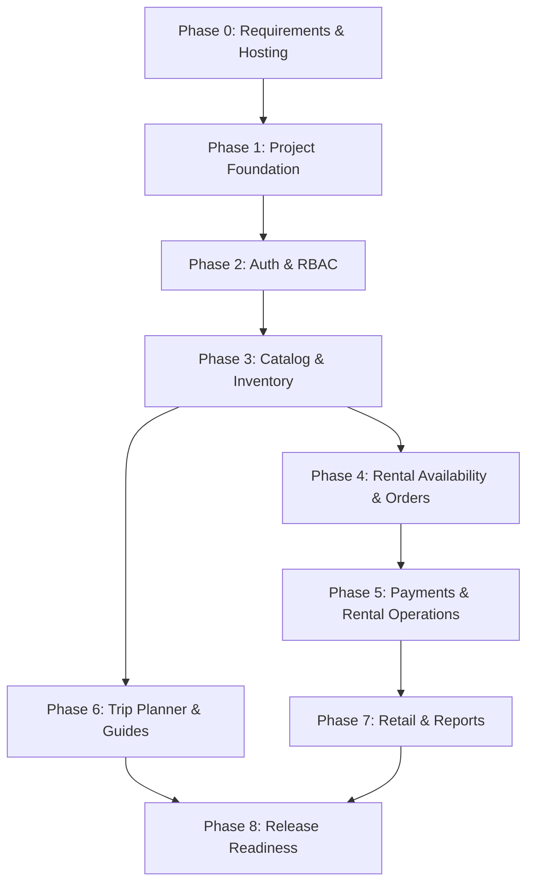

# Product & Development Roadmap — GEARORA

> **Product:** GEARORA — Outdoor Supply  
> **Document version:** 1.0  
> **Date:** 16 November 2026  
> **Planning style:** Phased delivery with dependencies and exit criteria

---

## 1. Roadmap Strategy

Roadmap GEARORA disusun berdasarkan urutan risiko dan ketergantungan sistem. Prioritas pertama bukan menambah sebanyak mungkin halaman, melainkan memastikan katalog, inventaris, reservasi, pembayaran, dan pengembalian bekerja dalam satu alur yang benar.

Prinsip delivery:

1. Validasi hosting dan spesifikasi runtime sebelum mengunci dependency.
2. Bangun fondasi database, autentikasi, dan otorisasi sebelum Admin Dashboard diperluas.
3. Selesaikan katalog dan pencatatan stok sebelum reservation engine.
4. Selesaikan order dan inventory consistency sebelum laporan/analytics.
5. Tambahkan rekomendasi trip, panduan, dan retail setelah alur rental inti stabil.
6. Sisihkan satu fase khusus untuk hardening, pengujian, deployment, dan dokumentasi.

## 2. Milestone Utama

| Milestone | Hasil yang harus tersedia |
|---|---|
| M0 — Validated Foundation | Spesifikasi final, hosting feasibility, local development environment, repository structure |
| M1 — App Foundation | Laravel berjalan, database terkoneksi, layout dasar dan route siap |
| M2 — Secure Admin | Login, session, role, permission, dan proteksi route admin |
| M3 — Catalog & Inventory | Kategori, produk, varian, unit rental, stok jual, dan stock movement |
| M4 — Rental MVP | Availability, order, perhitungan biaya, pembayaran manual, dan status order |
| M5 — Rental Operations | Pickup, return, inspection, deposit, biaya tambahan, dan laporan dasar |
| M6 — Customer Value Features | Trip recommendation dan equipment guides |
| M7 — Retail + Reporting | Sales order, dashboard/report yang lebih lengkap, ekspor CSV |
| M8 — Release Ready | Security, QA, backup, deployment smoke test, dan dokumentasi pengguna |

## 3. Phase 0 — Requirement Freeze & Hosting Validation

**Tujuan:** memastikan kebutuhan utama dan kemampuan hosting tidak saling bertentangan.

### Tasks

- [x] Setujui PRD, arsitektur, Tech Stack, dan Roadmap sebagai baseline. — dibekukan di `.docs/REQUIREMENT_FREEZE.md`.
- [x] Tetapkan kebijakan rental: tanggal/jam, durasi, pickup, return, pembatalan, keterlambatan, deposit, dan metode pembayaran. — `.docs/RENTAL_POLICY.md` v1.0 (baseline final MVP).
- [x] Tetapkan apakah GEARORA hanya memiliki satu lokasi usaha pada MVP. — **SATU LOKASI** (self pickup), diformalkan di `.docs/RENTAL_POLICY.md` §1; multi-cabang di luar MVP.
- [ ] Buka cPanel AeonFree dan cek versi PHP aktual. — **BLOCKED** (butuh akses cPanel); verifikasi publik 17 Nov 2026: PHP 8.2 (beranda) vs 7.4 (halaman hosting), konflik belum selesai.
- [ ] Cek ekstensi PHP wajib Laravel dan `pdo_mysql`. — **BLOCKED** (hosting); ekstensi lokal terverifikasi lengkap.
- [ ] Cek MySQL version dan pembuatan database/user. — **BLOCKED** (hosting); MySQL lokal 8.4.3 + database `gearora` dibuat dan terverifikasi.
- [ ] Cek apakah SSH/Terminal, Composer, cron, File Manager, dan phpMyAdmin tersedia. — **BLOCKED** (butuh akses cPanel); File Manager/phpMyAdmin hanya PUBLICLY DOCUMENTED.
- [ ] Cek kemampuan menempatkan source Laravel di luar `public_html`. — **BLOCKED** (butuh akses cPanel).
- [ ] Cek permission `storage` dan `bootstrap/cache`. — **BLOCKED** (hosting); lokal writable.
- [x] Siapkan PHP, Composer, Node, dan MySQL lokal yang kompatibel. — PHP 8.5.9, Composer 2.9.7, Node 26.13.0, npm 11.20.0, MySQL 8.4.3.
- [x] Tentukan versi Laravel sesuai PHP runtime yang benar-benar tersedia. — **FINAL**: Laravel 12.72.0; minimum PHP 8.2 (lokal 8.5.9). Hosting < PHP 8.2 diganti, bukan framework diturunkan.

### Deliverables

- [x] Hosting validation checklist yang terisi. — terisi; item yang butuh akun berstatus **BLOCKED**.
- [x] Keputusan final versi PHP/Laravel. — Laravel 12.72.0 final; minimum PHP 8.2; deployment gate di `.docs/PHASE_0_HOSTING_VALIDATION.md` §2.5.
- [x] Daftar aturan bisnis yang disetujui. — `.docs/RENTAL_POLICY.md` v1.0.
- [x] Struktur repository dan environment development. — selesai.

### Exit Criteria

Tidak ada blocker penting terkait versi PHP, ekstensi, document root, koneksi database, atau permission. Jika hosting gagal pada syarat keamanan/kompatibilitas, lanjutkan development lokal tetapi jangan deploy ke hosting tersebut.

**Status (17 Nov 2026): requirement, kebijakan bisnis, dan keputusan versi SELESAI. Validasi akun hosting BELUM dapat diselesaikan** karena tidak ada akses cPanel; 6 item tetap `BLOCKED`. Development lokal dilanjutkan; deployment produksi **ditahan** sampai pemilik menjalankan checklist §4 di `.docs/PHASE_0_HOSTING_VALIDATION.md`. Laporan: `.docs/PHASE_0_1_FINAL_REPORT.md`.

## 4. Phase 1 — Project Foundation

**Tujuan:** membuat kerangka aplikasi dan pola kerja konsisten.

### Tasks

- [x] Inisialisasi Laravel sesuai versi yang lolos Phase 0. — Laravel 12.72.0 (PROVISIONAL).
- [x] Konfigurasi `.env` lokal dan koneksi MySQL. — `.env.example` + `.env`; MySQL 8.4.3 terhubung, database `gearora` termigrasi.
- [x] Siapkan Git repository, `.gitignore`, dan branch workflow. — `main`; `.env` di-ignore.
- [x] Konfigurasi Vite dan Tailwind CSS. — Vite 6 + Tailwind 4; `npm run build` lulus.
- [x] Buat design tokens berdasarkan `Desain_Gearora.md`. — token warna + typography Poppins/Inter/Georgia.
- [x] Buat Blade layout public, customer, dan admin. — `x-layouts.public`, `x-layouts.customer`, `x-layouts.admin`; skeleton halaman `/katalog`, `/panduan`, `/akun`, dan view `admin/dashboard`.
- [x] Buat komponen dasar: button, input, badge, card, table, modal, alert, pagination. — 9 komponen di `resources/views/components/ui/` (termasuk empty-state).
- [x] Atur locale Indonesia, format Rupiah, dan timezone `Asia/Jakarta`. — locale `id`, timezone `Asia/Jakarta`, `App\Support\Rupiah` + helper `rupiah()`.
- [x] Buat error pages dan empty states awal. — 404/500 + komponen `x-ui.empty-state` dipakai di katalog, panduan, akun, dan admin.
- [x] Tambahkan smoke test bahwa aplikasi berjalan dan database terkoneksi. — 35 test, 101 assertion, lulus.

### Deliverables

- [x] Laravel app dapat dijalankan lokal.
- [x] Layout public dan admin skeleton. — public, customer, dan admin tersedia.
- [x] Design token dan komponen dasar. — token + 9 komponen UI siap.
- [x] Database connection serta migration awal. — MySQL terhubung + baseline migration.

### Exit Criteria

Aplikasi dapat start tanpa error, CSS/JS hasil build muncul, migrasi dapat dijalankan ulang pada database development, dan struktur layout konsisten.

**Status (17 Nov 2026): TERPENUHI.** Start tanpa error, aset build muncul, migrate/rollback lulus, 35 test (101 assertion) lulus, dan seluruh task Phase 1 selesai. Rincian: `.docs/PHASE_0_1_FINAL_REPORT.md`.

## 5. Phase 2 — Database Foundation, Authentication & RBAC

**Tujuan:** membangun identity dan kontrol akses sebelum modul administrasi.

### Tasks

- [x] Finalisasi ERD dan migration inti.
- [x] Buat model `User`, `Role`, dan `Permission`.
- [x] Implementasikan registrasi/login pelanggan.
- [x] Implementasikan login admin melalui route terpisah atau guard/policy yang jelas.
- [x] Buat middleware autentikasi admin.
- [x] Implementasikan RBAC minimum: Owner, Admin, Warehouse Staff, Customer.
- [x] Implementasikan Policy/Gate untuk setiap aksi sensitif.
- [x] Pastikan customer hanya dapat melihat pesanan miliknya.
- [x] Tambahkan rate limit login dan validasi password.
- [x] Buat audit log untuk perubahan akses dan aksi admin yang penting.

### Deliverables

- Authentication berjalan.
- Role/permission matrix diimplementasikan.
- Admin route terlindungi.
- Tests untuk akses yang diizinkan dan ditolak.

### Exit Criteria

Pengguna tanpa login tidak dapat mengakses halaman privat; customer tidak dapat membuka data customer lain; petugas gudang tidak dapat melakukan verifikasi pembayaran/ubah permission tanpa izin.

## 6. Phase 3 — Catalog & Inventory Management

**Tujuan:** menyediakan data produk yang valid dan stok yang dapat dipercaya.

### Tasks

- [x] CRUD kategori.
- [x] CRUD produk dan foto.
- [x] Safe product/variant lifecycle: modal view/edit, archive, dependency-aware permanent delete, deactivate, activity log, dan database regression test.
- [x] Tipe produk: rental, sale, atau both.
- [x] CRUD product variants (ukuran, kapasitas, warna, SKU).
- [x] Pencatatan stok produk jual.
- [x] Pencatatan unit fisik rental (`rental_assets`).
- [x] Status unit: available, reserved, rented, maintenance, damaged, lost.
- [x] Stock movement untuk barang masuk, penyesuaian, kerusakan, dan kehilangan.
- [x] Validasi upload foto dan optimasi gambar.
- [x] Katalog publik: pencarian, kategori, filter tipe layanan, pagination.
- [x] Detail produk menampilkan spesifikasi, harga, kondisi, dan varian.

### Deliverables

- Admin dapat mengelola katalog dan inventaris.
- Customer dapat melihat katalog dan detail produk.
- Riwayat perubahan stok tersedia.

### Exit Criteria

Setiap produk memiliki tipe dan data harga yang valid; unit rental dapat dilacak; stok jual dan rental tidak tercampur; produk nonaktif tidak dapat dipesan.

## 7. Phase 4 — Rental Availability & Order MVP

**Tujuan:** menyelesaikan alur inti pemesanan rental.

### Tasks

- [x] Implementasikan form tanggal mulai dan pengembalian.
- [x] Finalisasi aturan durasi dan overlap periode (`.docs/ADR_RENTAL_INTERVAL.md`).
- [x] Implementasikan `RentalAvailabilityService`.
- [x] Implementasikan perhitungan harga dengan snapshot saat order dibuat.
- [x] Implementasikan cart/booking summary (MVP satu varian per booking).
- [x] Implementasikan pembuatan rental order dan kode transaksi unik.
- [x] Tambahkan database transaction dan row locking untuk mencegah double allocation.
- [x] Buat status order dan validasi transisi.
- [x] Buat halaman riwayat/detail order pelanggan.
- [x] Buat halaman daftar/detail order pada Admin Dashboard.
- [x] Tambahkan test untuk tanggal beririsan, stok habis, quantity, dan reuse periode bersebelahan. **Catatan:** test concurrency sungguhan belum dilakukan; SQLite `:memory:` tidak memverifikasi row-lock MySQL.

### Deliverables

- Customer dapat membuat rental order.
- Sistem menolak booking yang tidak tersedia.
- Admin dapat meninjau pesanan dan statusnya.

### Exit Criteria

Seluruh test availability lulus, order menyimpan snapshot harga, dan tidak ada satu aset fisik yang dapat dialokasikan ke dua periode rental aktif yang beririsan.

## 8. Phase 5 — Payments & Rental Operations

**Tujuan:** memastikan proses bisnis setelah pemesanan dapat dijalankan.

### Tasks

- [x] Implementasikan instruksi pembayaran manual.
- [x] Upload bukti pembayaran yang aman.
- [x] Buat verifikasi pembayaran admin: verified/rejected + catatan.
- [x] Tambahkan Midtrans Snap Redirect + webhook terverifikasi (sandbox siap, verifikasi transaksi nyata BLOCKED tanpa kredensial).
- [x] Buat deposit record terpisah dari revenue.
- [x] Buat pencatatan pickup/handover dan petugas.
- [x] Implementasikan asset assignment untuk unit yang diserahkan.
- [x] Buat form inspeksi awal dan akhir.
- [x] Implementasikan return management dan due/overdue listing.
- [x] Buat additional charges dengan alasan, nominal, dan persetujuan admin.
- [x] Implementasikan penyelesaian/pengembalian deposit.
- [x] Buat dashboard operasional: rental aktif, due today, overdue, barang perawatan.
- [ ] Buat laporan rental dasar (ditunda ke Phase 7 laporan terpisah).

### Deliverables

- Alur rental dari pembayaran hingga kembali selesai.
- Admin dapat memproses dan mengaudit serah-terima/pengembalian.
- Deposit dan biaya tambahan memiliki riwayat.

### Exit Criteria

Order hanya selesai setelah proses return ditangani; unit rusak tidak kembali tersedia; pembayaran dan deposit tidak tercampur; setiap perubahan penting memiliki audit trail.

## 9. Phase 6 — Trip Planner & Equipment Guides

**Tujuan:** menghadirkan nilai edukasi dan persiapan perjalanan yang membedakan GEARORA dari katalog rental biasa.

### Tasks

- [x] Buat input trip planner: aktivitas, tujuan, durasi, peserta, kebutuhan khusus. — `TripPlanData`, `TripPlannerRequest`, `/rekomendasi-trip`.
- [x] Definisikan rule set rekomendasi berdasarkan kategori/varian produk. — `trip_recommendation_rules` + admin CRUD.
- [x] Buat service rekomendasi deterministik dan dapat diuji. — `TripRecommendationService`, `TripRecommendationRuleTest`.
- [x] Tampilkan rekomendasi beserta alasan/label kategori. — hasil `reason`, qty, mode, status ketersediaan.
- [x] Buat CRUD equipment guides untuk admin/editor. — `admin/guides` + `GuideService`.
- [x] Buat kategori panduan, slug, status draft/published, dan metadata sumber. — `guide_categories`, `equipment_guides`, `guide_sources`.
- [x] Buat halaman panduan publik. — `/panduan`, `/panduan/{slug}`, pencarian + filter kategori.
- [x] Tambahkan disclaimer bahwa daftar rekomendasi bukan jaminan keselamatan perjalanan. — blok "Catatan keselamatan" di halaman Trip Planner.

### Deliverables

- Trip planner dasar berbasis aturan.
- Admin dapat mengelola artikel panduan.
- Customer dapat membaca artikel dan rekomendasi.

### Exit Criteria

Setiap rekomendasi dapat ditelusuri ke aturan yang jelas; produk nonaktif tidak direkomendasikan; artikel draft tidak tampil ke publik; konten keselamatan menyertakan sumber tepercaya.

**Status (18 Nov 2026): SELESAI untuk implementasi + automated tests.** Bukti: 174 tests lulus (495 assertions), termasuk 40 test Phase 6. Verifikasi visual browser dan MySQL integration belum dicatat. Laporan: `.docs/PHASE_6_7_COMPLETION_REPORT.md`.

## 10. Phase 7 — Retail Sales & Expanded Reports

**Tujuan:** melengkapi jalur penjualan produk serta laporan manajemen.

### Tasks

- [x] Buat keranjang/pemesanan produk jual. — `SalesCartService`, session `retail_cart`, `/keranjang`.
- [x] Pisahkan sales order dari rental order. — `sales_orders`/`sales_order_items` terpisah.
- [x] Terapkan pengurangan stok jual pada status transaksi yang ditetapkan. — `SalesStockService`: reserve saat checkout, consume saat settlement.
- [x] Buat verifikasi pembayaran/konfirmasi penjualan sesuai metode yang tersedia. — transfer/cash/Midtrans + admin verify/reject/cash.
- [x] Buat Admin Sales Order Management. — `admin/sales` daftar, detail, transisi, pembayaran.
- [x] Tambahkan laporan pendapatan sewa vs penjualan. — `ReportService` key `rental` dan `sales`.
- [x] Tambahkan laporan pembayaran, deposit, keterlambatan, kerusakan, dan stock movement. — key `payments`, `deposits`, `charges`, `inventory`, `operations`.
- [x] Buat filter periode dan export CSV. — `ReportFilterRequest`, `CsvExporter` dengan proteksi formula injection.
- [x] Validasi semua total laporan terhadap transaksi sumber. — `ExpandedReportsTest`, `CsvReportExportTest`.

### Deliverables

- Customer dapat membeli produk tipe sale.
- Admin dapat memproses sales order.
- Laporan membedakan omzet rental, sales, deposit, dan biaya tambahan.

### Exit Criteria

Sales tidak mengubah data rental; stok berkurang sesuai kebijakan; laporan dapat direkonsiliasi dengan transaksi yang sudah diverifikasi.

**Status (18 Nov 2026): SELESAI untuk implementasi + automated tests.** Bukti: 50 test Phase 7 hijau, `vendor/bin/pint --test` bersih. Blocker: verifikasi Midtrans Sandbox nyata dan MySQL `gearora_test` belum tersedia. Laporan: `.docs/PHASE_6_7_COMPLETION_REPORT.md`.

## 11. Phase 8 — Quality, Security & Release Readiness

**Tujuan:** mempersiapkan demonstrasi dan deployment yang aman.

### Tasks

- [ ] Jalankan seluruh unit dan feature tests.
- [ ] Uji role/permission untuk semua route admin.
- [ ] Uji CSRF, validasi, rate limiting, upload, dan akses file privat.
- [ ] Uji date overlap dan transaksi bersamaan.
- [ ] Periksa query N+1, pagination, dan indeks database.
- [ ] Uji responsive customer pages dan Admin Dashboard.
- [ ] Lakukan accessibility pass pada form, tabel, modal, dan status.
- [ ] Jalankan dependency audit dan hapus package tidak terpakai.
- [ ] Siapkan backup database dan file upload.
- [ ] Siapkan production `.env` tanpa memasukkannya ke Git.
- [ ] Build asset dan Composer dependencies secara lokal.
- [ ] Deploy ke AeonFree hanya setelah document root dan ekstensi dinyatakan aman.
- [ ] Jalankan deployment smoke tests.
- [ ] Buat README instalasi, panduan admin, dan panduan penggunaan.

### Deliverables

- Release candidate.
- Test report/checklist.
- Backup & restore procedure.
- Deployment notes dan user documentation.

### Exit Criteria

Tidak ada blocker security atau data integrity; alur utama lulus test; file sensitif tidak publik; backup dapat diuji; aplikasi dapat digunakan pada environment target tanpa fitur yang memerlukan daemon.

## 12. Cross-Phase Definition of Done

Setiap fitur dianggap selesai jika:

- [ ] Acceptance criteria pada PRD terpenuhi.
- [ ] Request divalidasi di server.
- [ ] Permission diperiksa di server.
- [ ] Aturan bisnis ditempatkan pada service/model yang tepat.
- [ ] Loading, empty, success, dan error states ditangani.
- [ ] Data penting memiliki migration dan constraint yang sesuai.
- [ ] Test otomatis ditambahkan untuk logika kritis.
- [ ] UI responsive dan dapat diakses dengan keyboard.
- [ ] Tidak ada credential atau data sensitif di source control.
- [ ] Dokumentasi singkat diperbarui.

## 13. Dependency Map

Phase 6 dapat berjalan paralel setelah katalog tersedia, tetapi seluruh fitur harus lolos quality gate Phase 8.

## 14. Prioritas Implementasi Admin Dashboard

Urutan implementasi admin yang direkomendasikan:

1. Admin Authentication, RBAC, dan layout dashboard.
2. Dashboard overview dengan data riil minimal.
3. Categories, Products, Product Variants.
4. Inventory, Rental Assets, dan Stock Movements.
5. Rental Orders dan Availability.
6. Payments dan verifikasi manual.
7. Pickup, Returns, Inspections, Deposits, Additional Charges.
8. Sales Orders.
9. Trip Planner Rules dan Equipment Guides.
10. Reports, export, audit, dan release hardening.

Jangan membangun semua halaman dashboard sebagai UI statis terlebih dahulu. Setiap modul harus dihubungkan dengan model, policy, validasi, alur status, dan test terkait.

## 15. Delivery Tracking Template

Gunakan status berikut pada issue/board proyek:

- `BACKLOG`: belum dimulai.
- `READY`: kebutuhan dan acceptance criteria sudah jelas.
- `IN_PROGRESS`: sedang dikembangkan.
- `IN_REVIEW`: menunggu review/testing.
- `BLOCKED`: bergantung pada keputusan atau masalah eksternal.
- `DONE`: Definition of Done terpenuhi.

Untuk tiap task, catat: phase, modul, acceptance criteria, migration yang dibutuhkan, test yang ditambahkan, dan bukti uji.

## 16. Risiko Roadmap

| Risiko | Dampak | Mitigasi |
|---|---|---|
| PHP/extension AeonFree tidak sesuai | Aplikasi tidak dapat berjalan | Validasi Phase 0 sebelum lock dependency |
| PHP 8.2 hanya tersedia | Laravel 12 memiliki sisa masa security support terbatas | Periksa opsi PHP 8.3/upgrade sebelum 24 Feb 2027 |
| Tidak tersedia SSH/Composer | Deployment lebih manual | Build dependencies secara lokal, dokumentasikan upload |
| Document root tidak dapat diamankan | Source/.env dapat terpapar | Hentikan deployment sampai private/public split aman |
| Aturan tanggal rental belum jelas | Salah hitung biaya/overbooking | Tetapkan kebijakan dan uji edge cases sebelum Phase 4 |
| Inventaris hanya dihitung sebagai angka total | Unit ganda/riwayat kondisi tidak akurat | Gunakan unit fisik untuk aset rental |
| Scope dashboard terlalu luas | Fitur inti tidak selesai | Ikuti urutan P0 lalu P1/P2 |
| Tidak ada cron/worker | Pengingat/expiry otomatis tidak berjalan | MVP memakai pemeriksaan on-demand dan operasi manual |

## 17. Dokumen Acuan

- [PRD GEARORA](./PRD_GEARORA.md)
- [Architecture GEARORA](./ARCHITECTURE_GEARORA.md)
- [Tech Stack GEARORA](./TECH_STACK_GEARORA.md)
- [Proposal konsep GEARORA](https://github.com/KiandrAHD/Gearora/blob/main/.Gearora/GEARORA.md)
- [Homepage design reference](https://github.com/KiandrAHD/Gearora/blob/main/.docs/Desain_Gearora.md)
